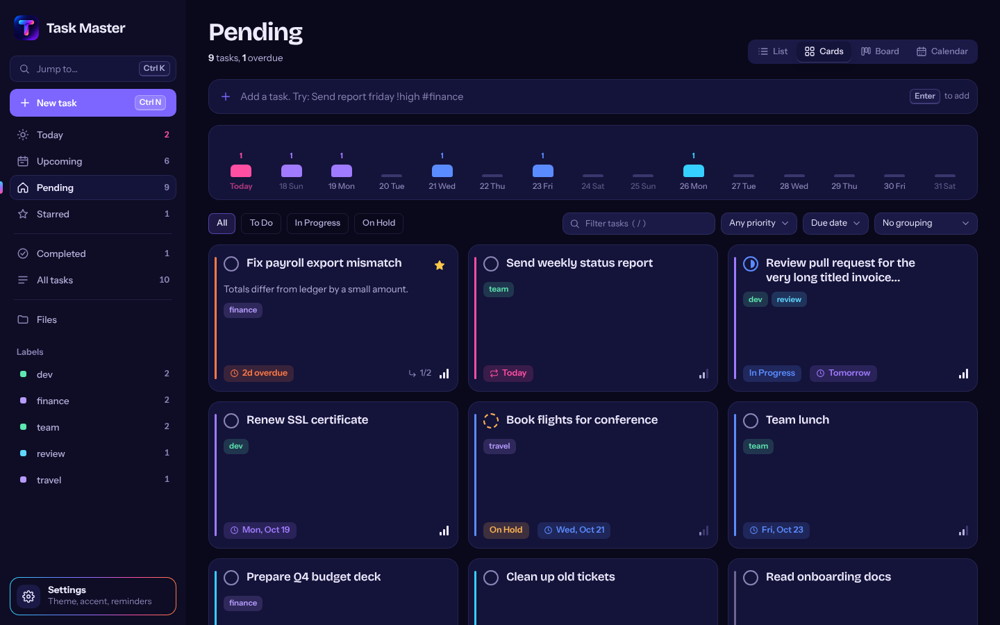
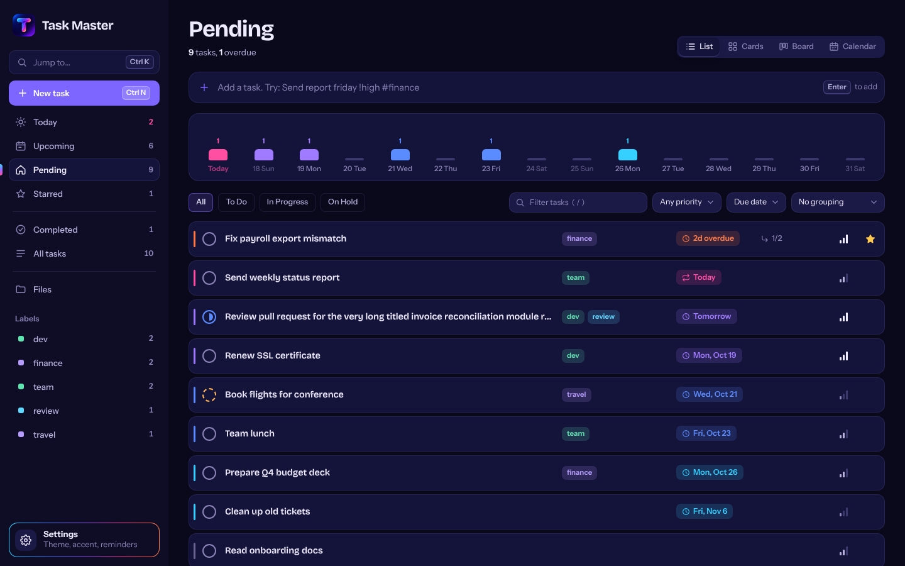
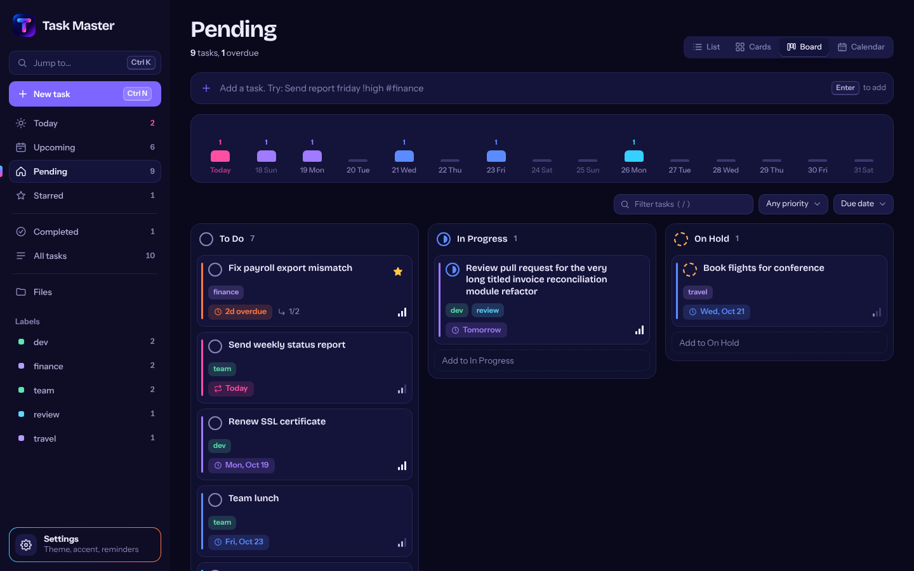
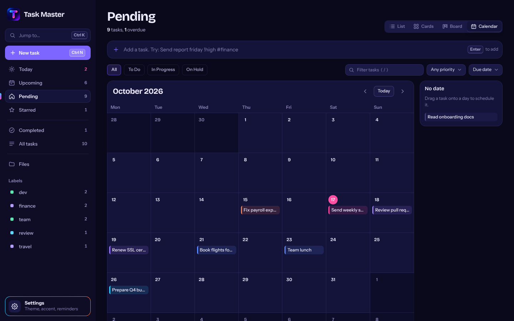
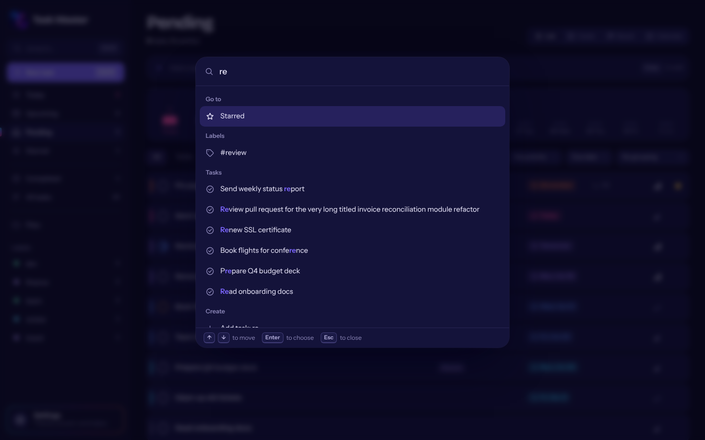
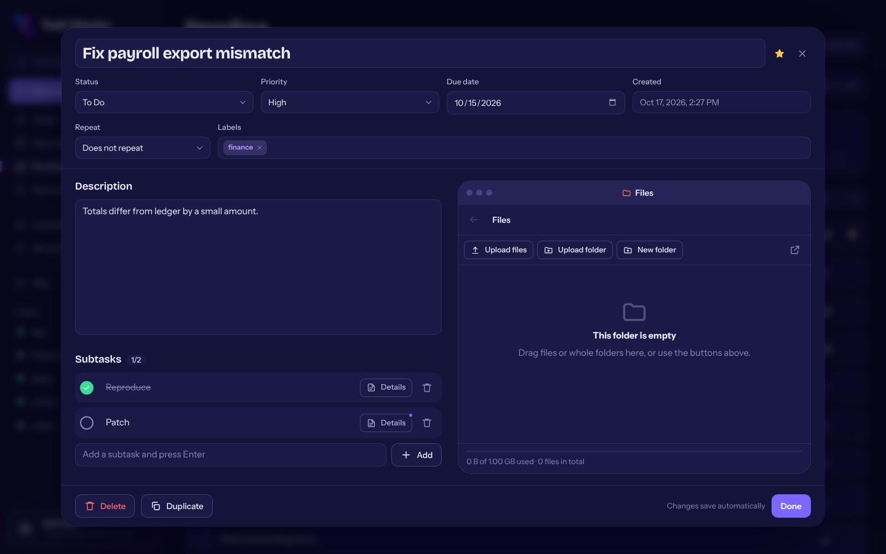
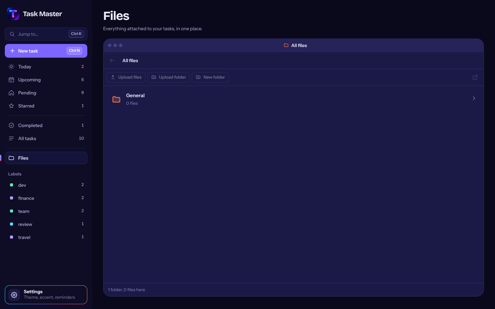
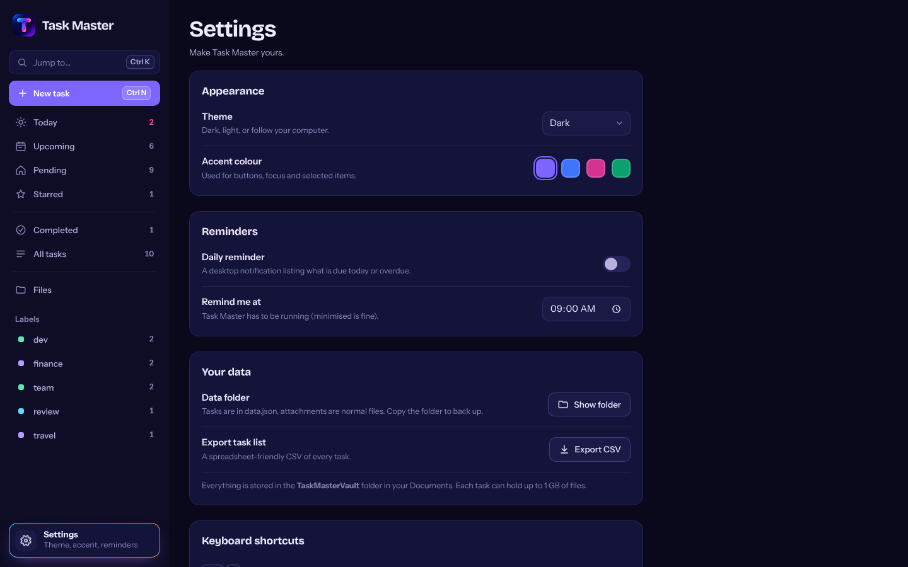
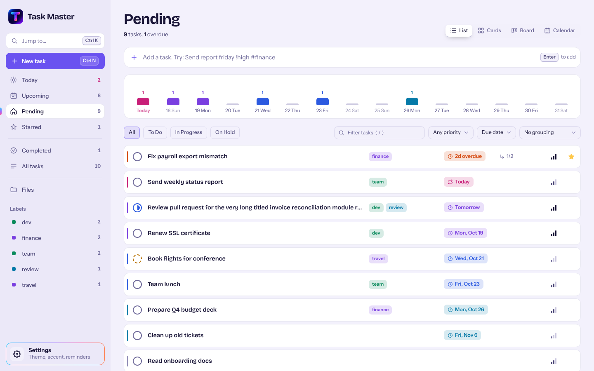
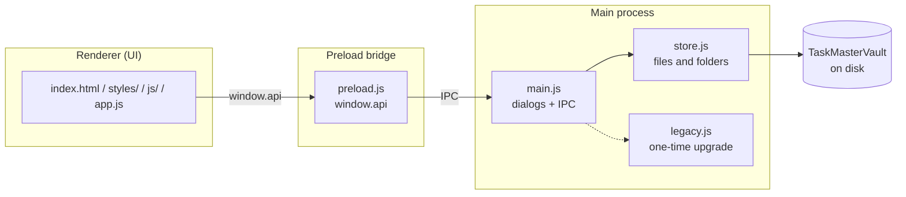

<div align="center">


# Task Master

**A fast, offline desktop to-do manager for your work.**
Tasks, subtasks, notes and files live on your own PC. No cloud, no account, no tracking.


</div>

<p align="center">
  
</p>

---

## Table of contents

- [Overview](#overview)
- [Features](#features)
- [Screenshots](#screenshots)
- [Quick start](#quick-start)
- [Building an installer](#building-an-installer)
- [How it works](#how-it-works)
- [Usage guide](#usage-guide)
- [Data storage and backup](#data-storage-and-backup)
- [Upgrading from an older version](#upgrading-from-an-older-version)
- [Project structure](#project-structure)
- [Configuration](#configuration)
- [Testing](#testing)
- [Troubleshooting](#troubleshooting)
- [Limitations](#limitations)
- [Roadmap](#roadmap)
- [Contributing](#contributing)
- [License](#license)

---

## Overview

Task Master keeps your pending work in one place. The home page lists every task that still needs doing. Click a task to open a popup where you write notes, break the task into subtasks, and manage its files in a built-in file browser.

It is built for one person on one computer: quick to open, nothing to sign up for, and nothing leaves your machine. Your data is stored as ordinary files and folders, so you can always open it in Explorer or Finder too.

## Features

### Task management
- **Four views** of the same tasks: **List**, **Cards**, **Board** (kanban, drag a card to change its status) and **Calendar** (drag a task to reschedule it)
- **Quick add:** type `Send report friday !high #finance` and press Enter. Dates (`tomorrow`, `next mon`, `oct 28`), priority (`!high`), labels (`#finance`) and repeats (`every week`) are understood, with a live preview
- **Command palette (`Ctrl+K`):** search tasks, jump to any page or label, switch view or theme, or add a task
- **Smart pages:** Today (due or overdue), Upcoming, Pending, Starred, Completed, All tasks
- **Labels** with their own colour and a sidebar list, and **stars** for the tasks that matter
- **Repeating tasks:** finish a repeating task and the next one is created automatically
- **Undo** after completing, moving, adding or rescheduling a task
- **15-day runway:** a strip of the next two weeks showing how much is due each day; click a day to filter
- **Group by** due date, status, priority or label
- **Duplicate** a task with its subtasks, **daily reminder** notification
- **Task fields:** heading, created date (automatic), status, due date, priority, labels, repeat
- **Deadline colours:** every task has a coloured edge and date chip that run from cool cyan (far away) to hot pink (today) and ember (overdue)
- **Search, filters and sorting** by status, priority, due date, newest or A-Z
- **One-click complete** from the ring on any task

### Task popup
- **Status, priority, due date and created date** in a single row
- **Description** with notepad-style editing (see below)
- **Subtasks**, each with a done tick and a **Details** button that opens a notes area for that subtask
- **Labels, repeat and star** next to the other properties
- **File window** on the right side of the popup (see below)
- **Autosave:** changes are saved as you type

### Notepad-style notes (no toolbar)
The description and every subtask's details box behave like a modern notepad, using only the keyboard:

| You do this | You get |
| --- | --- |
| Press `Tab` | Indents the line (or every selected line) |
| Press `Shift+Tab` | Outdents |
| Type `* ` at the start of a line | A bullet `•` |
| Type `- ` or `1. ` at the start of a line | A dash list or a numbered list |
| Press `Enter` in a list item | The next item appears automatically (`1.` becomes `2.`) |
| Press `Enter` on an empty item | Steps out one level, or ends the list |
| Press `Backspace` right after a marker | Removes the marker |
| Press `Tab` on a list item | Makes it a nested item (numbers restart per level) |
| `Ctrl+Z` / `Ctrl+Y` | Undo and redo work normally |

### File window
Every task has its own file window, shown as a small window on the right side of the popup.

- **Upload files** or **upload an entire folder**, with all its subfolders
- **Drag and drop** files or whole folders from your PC straight into the window
- **Folder navigation** like a file explorer: click a folder to go inside, use the back arrow or the path at the top to go up
- **Create folders**, **rename**, **delete**, and **drag items onto a folder** to move them
- **Open** a file with its normal program, or **save a copy** of a file or folder anywhere on your PC
- **Storage meter:** up to 1 GB of files per task
- A **Files** page in the sidebar shows everything in one place: a General area plus one folder per task

### Quality of life
- Dark, light and match-system themes, plus four accent colours
- Export your task list to CSV (with labels and repeat)
- Keyboard shortcuts, listed in Settings
- Custom app icon

## Screenshots

| | |
| --- | --- |
| **List view** <br>  | **Cards view** <br>  |
| **Board** <br>  | **Calendar** <br>  |
| **Command palette** <br>  | |
| **Task popup with file window** <br>  | **Files page** <br>  |
| **Settings** <br>  | **Light theme** <br>  |

## Quick start

### Requirements

| Requirement | Version |
| --- | --- |
| [Node.js](https://nodejs.org) | 18 or newer (LTS recommended) |
| npm | Included with Node.js |
| Operating system | Windows 10/11, macOS, or Linux |

### Run from source

```bash
# 1. Get the code
git clone <your-repository-url> task-master
cd task-master

# 2. Install dependencies (first time only)
npm install

# 3. Start the app
npm start
```

There is nothing to set up: no login and no password. The app opens straight to your tasks.

## Building an installer

Build on the operating system you are targeting.

| Command | Output | Build on |
| --- | --- | --- |
| `npm run dist:win` | Windows installer (`.exe`) and portable `.exe` | Windows |
| `npm run dist:mac` | macOS `.dmg` | macOS |
| `npm run dist:linux` | Linux `.AppImage` | Linux |

Results are written to the `dist/` folder. Delete `dist/` before rebuilding so old files do not mix with new ones.

Notes for Windows:
- The app is not code-signed, so Windows SmartScreen may warn on first run. Choose **More info**, then **Run anyway**.
- If the build stops with "Cannot create symbolic link", turn on **Developer Mode** in Windows Settings, or run the terminal as Administrator, then retry.
- If an old icon still shows after installing, uninstall the previous version first. Windows caches icons.

## How it works

### Architecture



- The **renderer** is the interface. It has no direct access to your files or to Node.js.
- The **preload bridge** exposes a small, fixed set of functions to the interface.
- The **main process** opens file dialogs and calls the store.
- The **store** reads and writes your data. Every path it receives is checked so it can never reach outside the data folder.
- **legacy.js** only runs once, to convert data from older encrypted versions.

### Data layout

```text
TaskMasterVault/
├── data.json                 Tasks, subtasks, descriptions and settings
└── files/
    ├── general/              Files and folders not tied to a task
    └── tasks/
        └── <task id>/        Everything attached to one task, with your own subfolders
```

`data.json` holds each task as plain JSON:

```text
tasks[]  id, title, description, status, priority,
         createdAt, dueDate, completedAt,
         subtasks[] { id, title, description, done }
settings { theme, layout }
```

Attached files are not listed in `data.json`. The folders on disk are the source of truth, which is why the file window always matches what you see in Explorer or Finder.

## Usage guide

### Creating a task
1. Click **New task** (or press `Ctrl+N`).
2. Enter a heading. The created date is filled in automatically.
3. Choose a status, due date and priority, then click **Create task**.

### Working in the task popup
Click any task card to open it.
- Write a **description** in the left column. Use `Tab`, `*` and `1.` as described in [Notepad-style notes](#notepad-style-notes-no-toolbar).
- Type a subtask title and press `Enter`. Click **Details** on a subtask to open its notes area.
- Tick a subtask to mark it done. The card's progress bar updates.
- Use the **file window** on the right to add and organize files for this task.

### Using the file window
- **Upload files** picks one or more files. **Upload folder** picks a whole folder and keeps its structure.
- Click a folder to open it. Click the back arrow, or any part of the path at the top, to go up.
- Hover a row for **save a copy**, **rename** and **delete**. Drag a row onto a folder to move it.
- Click a file to open it in its normal program.
- The arrow icon at the top right shows the current folder in your system file explorer.

### Keyboard shortcuts

| Shortcut | Action |
| --- | --- |
| `Ctrl+N` | New task |
| `/` | Focus search |
| `Esc` | Close the open popup |
| `Tab` / `Shift+Tab` | Indent / outdent in notes |

### Settings

| Setting | Options |
| --- | --- |
| Theme | Dark, Light, Match system |
| Data folder | Open it in your file explorer |
| Export | Task list as CSV |

## Data storage and backup

Your data is stored in `Documents/TaskMasterVault/`.

**To back up**, close the app and copy the whole `TaskMasterVault` folder.

**To restore or move to another PC**, close the app, then put the folder in that PC's `Documents` folder.

> **Privacy note:** the app does not encrypt your data. Anyone who can open your user account or the folder can read your tasks and files. For disk-level protection, use your operating system's built-in tools (BitLocker on Windows, FileVault on macOS).

## Upgrading from an older version

Earlier versions encrypted files behind a master password or a key. This version stores everything as plain files. On first launch the app converts old data automatically:

- If your old key can be read on this computer, the upgrade happens silently.
- Otherwise the app asks once for your **old master password**, or for your **key backup file**.
- After conversion the old key files are removed. A folder named `WorkTodoVault` from the earliest versions is also picked up and renamed.

## Project structure

```text
task-master/
├── build/
│   ├── icon.png          App icon (Linux/macOS, and source artwork)
│   ├── icon.ico          App icon (Windows)
│   └── afterPack.js      Embeds the icon into the Windows .exe
├── docs/
│   └── screenshots/      Images used in this README
├── src/
│   ├── main.js           Electron main process, dialogs and IPC
│   ├── preload.js        Secure bridge exposing window.api
│   ├── store.js          Plain file and folder storage
│   ├── legacy.js         One-time upgrade from older encrypted versions
│   ├── icon.png          Window and taskbar icon
│   └── renderer/
│       ├── index.html    App shell: lists the stylesheets and scripts in load order
│       ├── app.js        Start-up (loads data, then draws the app)
│       ├── logo.png      In-app logo
│       ├── fonts/        Bundled fonts (offline), see fonts/LICENSE.txt
│       ├── styles/       All styling, split by area. Start with tokens.css
│       └── js/           parse.js, core.js, notepad.js, files.js, tasks.js,
│                         views.js, popup.js, palette.js, settings.js
├── test/
│   ├── store.test.js     Storage and upgrade tests
│   └── parse.test.js     Quick-add parser and repeat-date tests
├── package.json
├── .gitignore
├── LICENSE
└── README.md
```

## Configuration

| What | Where |
| --- | --- |
| Per-task storage limit (default 1 GB) | `TASK_LIMIT` at the top of `src/store.js` |
| Data folder location | `dataDir` at the top of `src/main.js` |
| App name, id and installer options | the `build` section of `package.json` |
| App icon | replace the files in `build/` and `src/`, keeping the same names |
| Colours, fonts, spacing, corners | the variables in `src/renderer/styles/tokens.css` (full guide: [docs/STYLING.md](docs/STYLING.md)) |
| Notepad indent width | `IND` inside `attachNotepad` in `src/renderer/js/notepad.js` |

To change the logo, replace `build/icon.png`, `build/icon.ico`, `src/icon.png` and `src/renderer/logo.png`. Use a square PNG of at least 512 by 512 pixels.

## Testing

```bash
npm test
```

The tests check that:
- files and whole folders are copied in with their structure intact
- the per-task 1 GB limit is enforced
- paths that try to escape the data folder are rejected
- rename, move and delete work, and a folder cannot be moved into itself
- data from older encrypted versions is converted correctly

## Troubleshooting

| Problem | Fix |
| --- | --- |
| `npm` is not recognized | Install Node.js from nodejs.org, then open a new terminal |
| Windows SmartScreen warning | The app is unsigned. Choose **More info**, then **Run anyway** |
| "Cannot create symbolic link" during build | Enable Developer Mode in Windows, or run the terminal as Administrator |
| Old icon still shows | Uninstall the old version and restart Explorer, since Windows caches icons |
| Upload blocked with a limit message | That task has reached 1 GB. Delete files or raise `TASK_LIMIT` |
| The app asks for an old password on first launch | It found data from an older encrypted version. Enter the old password, or choose your key backup file |
| Linux: app will not start from AppImage | Run `chmod +x` on the file, or start with `--no-sandbox` |

## Limitations

- Single user, single computer. There is no sync between devices
- Data is stored unencrypted (see the privacy note above)
- The Windows build is unsigned
- No reminders or notifications yet

## Roadmap

- [ ] Reminders and notifications for due dates
- [ ] Recurring tasks
- [ ] Tags and labels
- [ ] Import from CSV
- [ ] Calendar view

## Contributing

Contributions are welcome.

1. Fork the repository and create a branch: `git checkout -b feature/my-change`
2. Make your change and run `npm test`
3. Commit with a clear message and open a pull request describing what changed and why

Please keep changes focused, and do not commit any personal task data.

## License

Released under the [MIT License](LICENSE).
